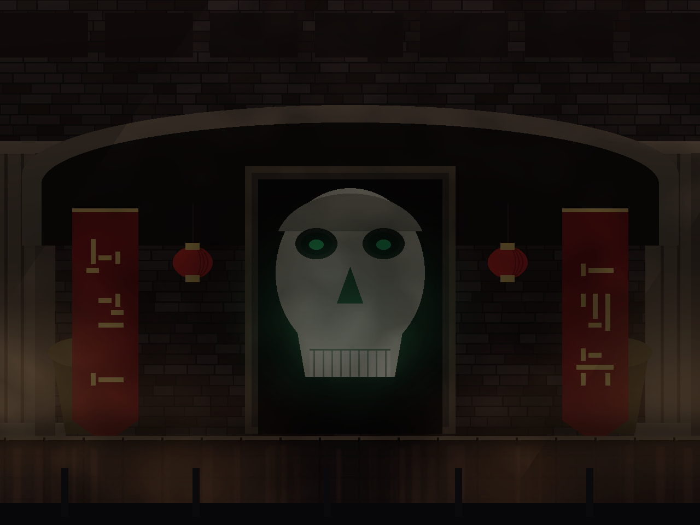
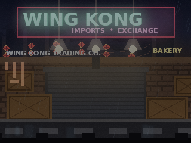
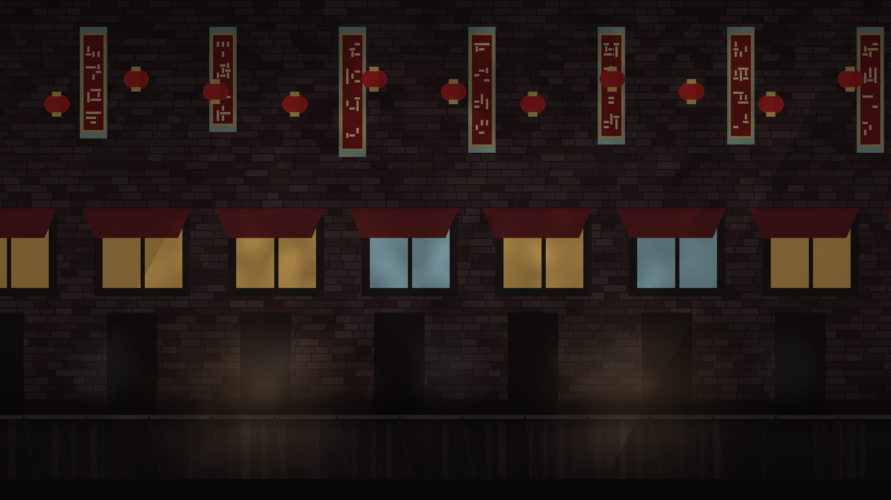
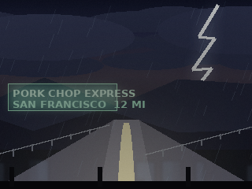
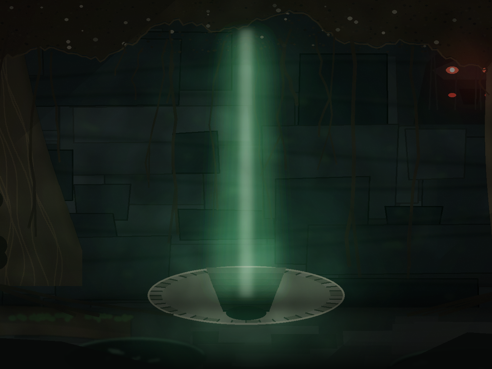

# Big Trouble in Little China: The Game

A fan-made 2D fighting game built on [Ikemen GO](https://github.com/ikemen-engine/Ikemen-GO),
the open-source engine that runs M.U.G.E.N resources. Inspired by John Carpenter's
1986 film *Big Trouble in Little China*: truckers, sorcerers, the Three Storms,
and an emperor who has been waiting two thousand years for a wedding.

This repository is the **game** (roster, stages, screenpack config, tooling). The
engine binary is not committed here — the
[releases](https://github.com/jackrabbit72380/bigtroubleinlittlechinathegame/releases/latest)
ship it bundled, so players just download and launch.







## Download and play

Nothing to install — every release zip already contains the Ikemen GO engine with
this game's fighters, stages and screenpack in place.

| Platform | File | Launch |
|---|---|---|
| Windows | `BigTroubleInLittleChina-Windows.zip` | unzip, double-click `Ikemen_GO.exe` |
| Linux | `BigTroubleInLittleChina-Linux.zip` | unzip, `chmod +x Ikemen_GO_Linux && ./Ikemen_GO_Linux` |
| macOS | `BigTroubleInLittleChina-macOS.zip` | unzip, right-click the app → **Open** the first time |

Grab them from the
[latest release](https://github.com/jackrabbit72380/bigtroubleinlittlechinathegame/releases/latest).
Releases are produced by the `Build release bundles` workflow, which downloads the
official engine build for each platform, copies this game's files over it, checks
that the executable, roster, stages and engine licence are all present, then
publishes the zips.

If a bundle trips SmartScreen (Windows) or Gatekeeper (macOS), that is because the
downloads are unsigned: choose *More info → Run anyway*, or right-click → *Open*.

## Run from source

The rest of this README is for editing the game. If you only want to play, use a
release above.

1. Download an Ikemen GO build (Windows/Linux/macOS) from the
   [releases page](https://github.com/ikemen-engine/Ikemen-GO/releases) — the
   nightly is what the bundled screenpack targets.
2. Copy the engine executable into this folder, next to `data/`.

   ```
   bigtroubleinlittlechinathegame/
     Ikemen_GO.exe          <- drop the engine here
     data/                  <- screenpack + system config (this repo)
     chars/                 <- fighters (this repo)
     stages/                <- arenas (this repo)
     font/ external/        <- engine support files (this repo)
     tools/                 <- asset generators + validator (this repo)
   ```

3. Run the engine. The default motif reads `data/ikemen1/system.def`, which
   points at `data/select.def` — the roster in this repo.

On Linux, `chmod +x Ikemen_GO_Linux` first. If the engine reports a missing
`.dll`/`.so`, you copied the binary out of its release archive without the
sibling libraries — keep the release folder intact and only replace its
`data/`, `chars/` and `stages/` with these.

## Roster

| Fighter | Role | Life | ATK | DEF | Notes |
|---|---|---|---|---|---|
| Jack Burton | hero | 1050 | 105 | 100 | balanced, "It's all in the reflexes" |
| Wang Chi | hero | 950 | 108 | 95 | faster, lower defence |
| Gracie Law | hero | 880 | 94 | 92 | fastest, lowest damage |
| Egg Shen | hero | 900 | 115 | 88 | glass cannon sorcerer |
| Rain | storm | 950 | 100 | 96 | first-tier ladder opponent |
| Lightning | storm | 1000 | 105 | 100 | first-tier ladder opponent |
| Thunder | storm | 1200 | 115 | 112 | heavy, scaled up 12% |
| Lo Pan | boss | 1300 | 125 | 112 | final boss |

Each fighter has their own folder with a `.def`, `.cmd`, `.cns`, `.air`, `.sff`,
`.snd` and a themed `movelist.dat`, plus movie-flavoured victory quotes in the
CNS `[Quotes]` section. Stats, scale and colours are listed once in
`tools/build_chars.py` (`ROSTER`) and regenerated from there.

### Moves (shared command set)

| Input | Move |
|---|---|
| `F + X` / `DF + X` | high / low guard |
| `B or F + Y` | throw |
| `QCF + P` | palm special (light/strong/fast on x/y/xy) |
| `D-S-F + P` | rising upper |
| `QCB + P` | blow |
| `QDF + K` | kick special |
| `F, F + K` | dash kick |
| `QCF, QCF + P` | super (1000 power) |
| `QCB, QCB + P` | super (1000 power) |

## Stages

| Stage | File | Setting |
|---|---|---|
| Lo Pan's Throne | `stages/lopans_throne.def` | skull gate you climb into, green neon, red glyphs |
| Wing Kong Exchange | `stages/wingkong_exchange.def` | loading bay, neon signage, rain |
| Chinatown Back Alley | `stages/chinatown_alley.def` | lanterns, vertical shop signs, steam |
| Pork Chop Express | `stages/porkchop_express.def` | storm highway, lightning, wet asphalt |
| The Upside Down | `stages/the_upside_down.def` | cavern roof, green light shaft, stair into the dark |
| Training Room | `stages/stage0.def` | the engine's training stage, kept for training mode |

All five BTILC stages are drawn procedurally (no bitmaps committed as source),
packed into SFF v2, and named for the film's locations. `tools/stages_hd.py`
paints them natively at **1280×960** (`localcoord = 1280, 960`), which is arcade
resolution times four — the engine no longer stretches a 240-line image across
a 1080p window, and a 16:9 display shows 1707 units of art instead of running to
black. Each stage canvas is **4000×960**: the camera travels ±1040 and the art
paints 960 past each end, with players clamped to ±1620. Ground line is row 800
(`zoffset = 800`). Each stage ships a `9000,1` select-screen preview sprite.

To put real art in a stage, drop `backdrop.png` (and optionally
`foreground.png`) into `art_src/<stage id>/` and rebuild — `tools/build_hd_stage.py`
replaces that stage with your image cover-fitted to the same 4000×960 canvas and
the same geometry, no code changes. That is the same HD stage model as a
high-resolution commercial fan remake, applied to art you own.

## Music

Menu music is read from `sound/` at the game root. `tools/build_music.py` writes
the paths into the `[Music]` block of `data/ikemen1/system.def` from the files it
finds there, so you drop a track in and the wiring is done for you:

| File | Screen |
|---|---|
| `sound/Title.ogg` | title screen |
| `sound/Select.ogg` | character select |
| `sound/Versus.ogg` | versus screen |
| `sound/Winner.ogg` | victory screen |
| `sound/Continue.ogg` | continue screen |
| `sound/Options.ogg`, `Replay.ogg`, `Results.ogg`, `Hiscore.ogg` | those screens |

Names are matched case-insensitively, but the file has to sit in `sound/` and use
an extension the engine can decode: **`.ogg` (Vorbis), `.mp3`, `.wav`, `.flac`,
or `.mid`/`.midi`** (MIDI needs a soundfont). The engine picks its decoder from
the extension, so `.opus`, `.m4a` and `.aac` files are ignored — renaming one to
`.ogg` will not help either. OGG is the best pick for menu loops: smallest and
gapless, and it wins when several encodings of the same track are present.

Each key keeps its `.volume`, `.loop`, `.loopstart` and `.loopend` siblings, which
the generator never touches; menus loop by default. Give several slots the same
filename if you want one track to run across them — the engine only restarts the
music when the filename changes.

Stage fight music is separate, per stage: the `[Music] bgmusic =` line of each
`stages/*.def` (blank today), for example `bgmusic = sound/fight_throne.ogg`.

Nothing in `sound/` is bundled in this repository yet, and release bundles now
copy that folder along with the rest of the game, so a track you add there also
ships in the downloads.

## Rebuilding assets

```sh
python3 tools/build_all.py        # every generator, then the validator
```

Or one at a time:

```sh
python3 tools/build_stages.py     # arcade-resolution stages (320-space)
python3 tools/stages_hd.py        # the same four arenas at 1280x960 (shipped)
python3 tools/stage_throne.py     # repaint Lo Pan's Throne from the concept art
python3 tools/stage_upside_down.py # paint The Upside Down, the fifth arena
python3 tools/build_hd_stage.py   # replaces any stage that has art_src/ art
python3 tools/build_chars.py      # regenerate the roster folders
python3 tools/build_music.py      # menu music paths in data/ikemen1/system.def
python3 tools/validate.py         # offline checks (no engine needed)
```

`tools/build_stages.py` accepts `STAGE_DEBUG=1` to dump each layer as PNG into
`artifacts/`. Set `STAGES_HD_PREVIEW_DIR` when running `tools/stages_hd.py` to
save 4:3 and 16:9 crops of each arena for eyeballing. Requirements: Python 3.9+ and Pillow (only the tooling needs it;
the game itself does not).

`tools/validate.py` verifies that every roster entry resolves, every character's
`.air` frame exists in its `.sff`, every stage layer sprite exists, select-screen
previews are present, and the roster is not accidentally all one palette. Run it
after any roster or stage edit.

On GitHub the `Build game assets` workflow does exactly this on every push that
touches the sources: it fetches the Ikemen GO release for the screenpack, fonts
and Kung Fu Man base, runs `tools/build_all.py`, and commits the resulting
`chars/`, `stages/`, `data/` and `artifacts/` output back to `main`.

## What is placeholder art, and what is original

Original to this repo:

* all five stage backdrops and their SFF files
* per-fighter palettes, stats, move lists, victory quotes
* the asset pipeline (`tools/`) and the validator
* `data/select.def` roster, arcade ladder and screenpack naming

Placeholder:

* **fighter sprites** are Kung Fu Man's (Elecbyte's sample character that ships
  with Ikemen GO) recoloured per fighter through graded palette tables. The
  silhouettes and animations are therefore all Kung Fu Man. `docs/DESIGN.md`
  explains the replacement path and why the palettes are baked into each SFF.
* **portraits** in the select screen are the same base character's portraits,
  recoloured the same way.
* audio — no music or voice is bundled. `sound/` and the stage `bgmusic` lines
  are yours to fill in; see [Music](#music).

Nothing in this repository is taken from the film: no stills, posters, music or
actor likenesses. Character names and move names are used as fan fiction.

## Legal

* Ikemen GO is licensed separately under the MIT licence — see its
  [LICENCE](https://github.com/ikemen-engine/Ikemen-GO/blob/develop/LICENCE.txt).
  The release bundles redistribute an unmodified engine build, and keep the
  engine's `LICENCE.txt` inside every zip as the licence requires.
* The IKEMEN1 screenpack in `data/ikemen1/` is by Ohmga Shironeko, redistributed
  under the terms of the Ikemen GO release it ships with.
* Kung Fu Man sprites are Elecbyte's sample assets.
* *Big Trouble in Little China* is a trademark of its rights holders. This is a
  non-commercial fan project; nothing here is licensed by or endorsed by them.
  If you plan to publish, replace the placeholder character art and audio.

## Roadmap

1. Replace Kung Fu Man silhouettes with original per-character sprite sets
   (see `docs/DESIGN.md` for the expected folder layout and animation list).
2. Character-specific specials — the shared command set is deliberate while all
   fighters share one animation set.
3. Intro/ending storyboards for arcade mode per fighter.
4. Original music and voice stings in `sound/`.
