# Big Trouble in Little China: The Game

A fan-made 2D fighting game for [Ikemen GO](https://github.com/ikemen-engine/Ikemen-GO) —
truckers, sorcerers, the Three Storms, and an emperor who has waited two thousand
years for a wedding. Twelve fighters, nine arenas painted at 1920×1080, and a HUD
where the dragons *are* the meters.

[](https://discord.gg/Bn2kABJsK5)
[](https://github.com/jackrabbit72380/bigtroubleinlittlechinathegame/releases/latest)


> **We are looking for people to build this with.** Coders, pixel and HD artists,
> musicians, and anyone who will play it and tell us what feels wrong — all of it
> is useful. Start with [Join development](#join-development) or just say hello in
> the [Discord](https://discord.gg/Bn2kABJsK5).

## The HUD

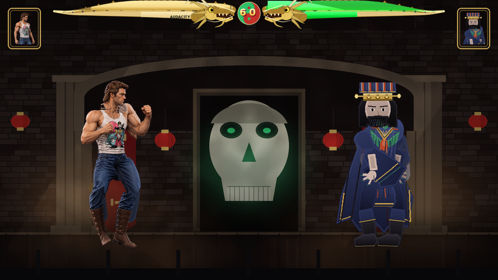

One dragon per side: its back is that player's health, its belly is audacity, and
its head turns in to the yin-yang timer. Red for player one, green for player two.
This render is composited from `data/fight.def` and `data/fight.sff` on every
build, so the picture above is always the HUD that actually ships — you can check
a change here without opening the engine.

## The arenas

| 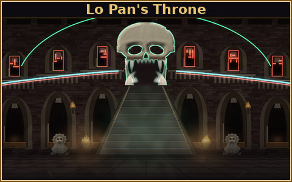 | 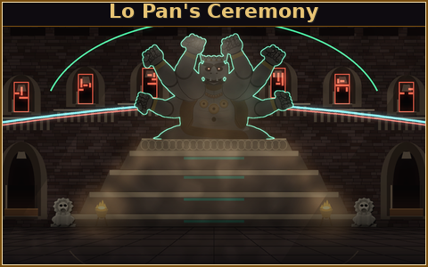 | 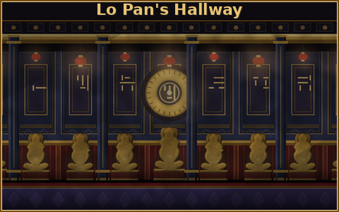 |
|:---:|:---:|:---:|
| **Lo Pan's Throne** | **Lo Pan's Ceremony** | **Lo Pan's Hallway** |
| 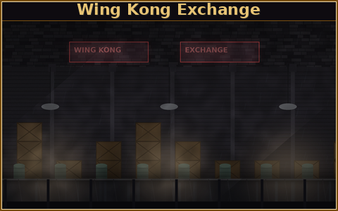 | 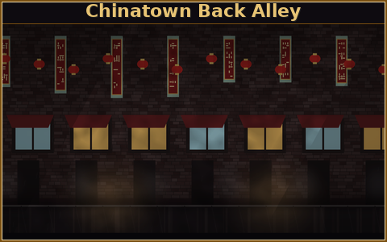 | 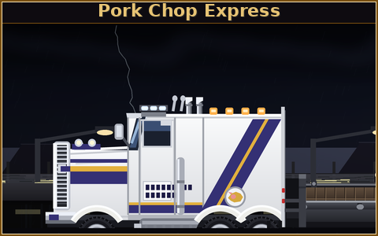 |
| **Wing Kong Exchange** | **Chinatown Back Alley** | **Pork Chop Express** |
| 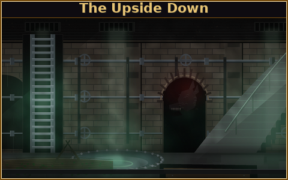 | 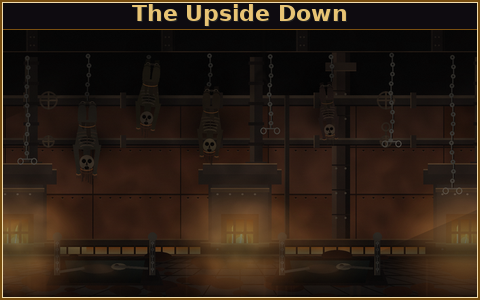 | 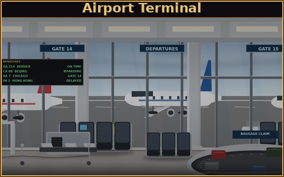 |
| **The Sewer** | **The Upside Down** | **Airport Terminal** |
| 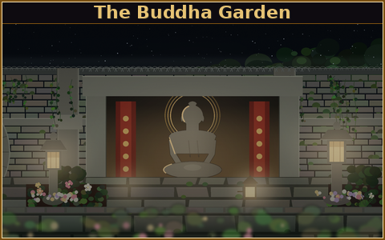 | 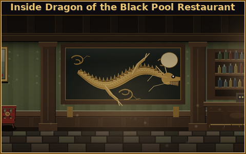 | 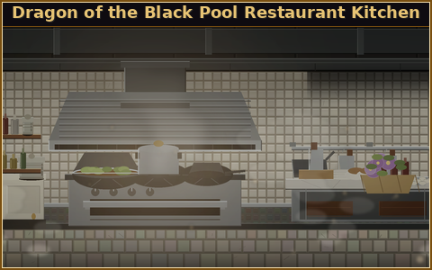 |
| **The Buddha Garden** | **Inside Dragon of the Black Pool Restaurant** | **Dragon of the Black Pool Restaurant Kitchen** |
| 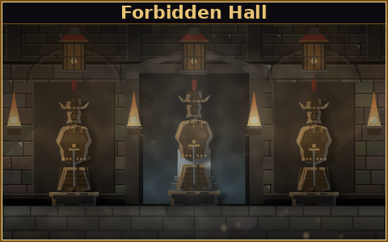 | 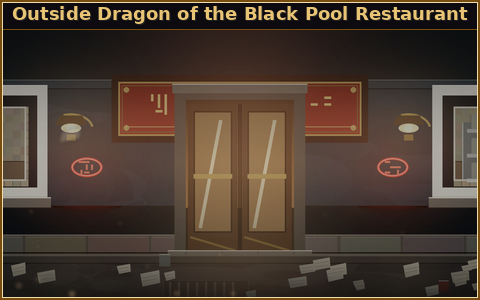 | 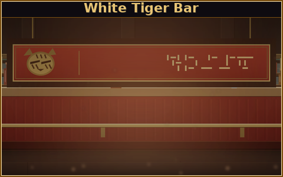 |
| **Forbidden Hall** | **Outside Dragon of the Black Pool Restaurant** | **White Tiger Bar** |
| 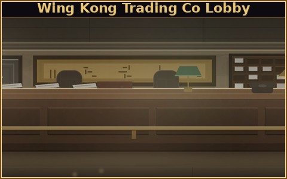 | | |
| **Wing Kong Trading Co Lobby** | | |
| 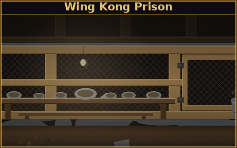 | | |
| **Wing Kong Prison** | | |
| 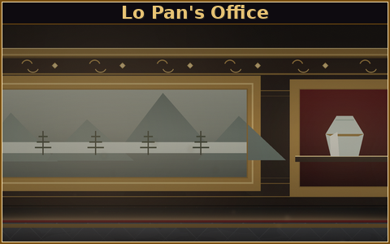 | | |
| **Lo Pan's Office** | | |

## Play it

Every release zip already contains the Ikemen GO engine with this game's fighters,
stages and screenpack in place. Nothing to install.

| Platform | File | Get going |
|---|---|---|
| Windows | `BigTroubleInLittleChina-Windows.zip` | unzip, run `BigTroubleInLittleChinaTheGame.exe` |
| Linux | `BigTroubleInLittleChina-Linux.zip` | unzip, `chmod +x BigTroubleInLittleChinaTheGame`, run it |
| macOS | `BigTroubleInLittleChina-macOS.zip` | unzip, right-click the app → **Open** the first time |

Grab them from the [latest release](https://github.com/jackrabbit72380/bigtroubleinlittlechinathegame/releases/latest).

### Windows will probably call the game a trojan

It is not one. The engine is a free open-source build with **no code-signing
certificate**, so Windows has no publisher to check and no reputation for the file,
and Defender's cloud checker labels a fresh copy `Trojan:Win32/Tecabans.A!cl`. The
`!cl` suffix means that verdict came from the cloud model, not from a virus
signature. The engine's own maintainers answered this exact report as a false alarm
([ikemen-engine/Ikemen-GO#2811](https://github.com/ikemen-engine/Ikemen-GO/issues/2811)),
and it comes back each time a new engine build is published.

Three things to check instead of taking anyone's word:

- `READ-ME-FIRST.txt` inside the Windows zip carries the SHA-256 of the game
  executable in that zip, and `SHA256SUMS.txt` on the release page hashes the
  download itself.
- Double-click **`ALLOW-THROUGH-DEFENDER.bat`** in the game folder. It adds that folder
  to Defender's exclusions (one administrator prompt) and prints whether each path
  really was added.
- If Defender already removed the file: Windows Security → Virus and threat
  protection → Protection history → the `Trojan:Win32/Tecabans.A!cl` entry →
  Actions → **Restore**, then run the game again.

SmartScreen or Gatekeeper prompts are the same unsigned-download story; a renderer
crash on boot is covered in [docs/INSTALL.md](docs/INSTALL.md).

### Play online

Nothing extra to install: the engine's own NETWORK menu does it. On one machine
pick NETWORK > HOST GAME and leave it waiting; on the other, NETWORK > JOIN GAME
> NEW ADDRESS, name the address anything, and type the host's address (port 7500
unless you changed it in `save\config.ini`). Both sides then pick VERSUS 2P.

The game runs from this one folder, on the engine that is in it, so the menus
and text look exactly as they should. Both players need the same build, so both
run **Update and Play.bat** on the same day before playing.

## What is in the build

- **Twelve fighters** with their own stats, palettes, movelists and victory quotes.
- **Nine arenas**, procedurally painted at **1920×1080** and packed into SFF v2,
  plus the engine's training room. Custom art drops straight in.
- **A custom screenpack** with a dragon HUD: the health bar is the dragon's back
  and the audacity meter is its underside, with the round timer on a glowing
  green and red yin-yang.
- **A +Chi reward** on every hit that lands, tracked per player.
- **An asset pipeline** in `tools/`: characters, stages, HUD art, music wiring and
  a validator, all reproducible from source — no hand-edited binaries.

## Join development

The game is built from code, not from a pile of opaque binary files: `tools/`
paints the stage backdrops, the HUD, the dragons and the character palettes, then
writes them into the engine's formats. That means a change starts as a small,
reviewable Python edit.

**Where help is wanted most:**

1. **Original fighter sprites** to replace the Kung Fu Man silhouettes — the
   biggest and most valuable job on the board. `docs/DESIGN.md` has the folder
   layout and animation list.
2. **Character-specific specials**, once fighters stop sharing one animation set.
3. **Intro and ending storyboards** for arcade mode.
4. **Music and voice stings** — `sound/` slots are wired and waiting.
5. **Playtesting**: tell us which move feels wrong, which stage reads badly at
   1080p, where the HUD fights the action.

**Get running in three commands** (Python 3.9+ and Pillow):

```sh
git clone https://github.com/jackrabbit72380/bigtroubleinlittlechinathegame.git
cd bigtroubleinlittlechinathegame
python3 tools/build_all.py     # regenerate everything, then validate
```

`python3 tools/validate.py` runs the offline checks — roster, frames, stage layers,
previews, palettes, launchers — with no engine required, so it is the fastest feedback loop
while you work.

Talk to us before starting anything large: the [Discord](https://discord.gg/Bn2kABJsK5)
is where the work is coordinated. Read [docs/CONTRIBUTING.md](docs/CONTRIBUTING.md)
for the pipeline, the art rules and the review expectations, and
[docs/DEV_KEYS.md](docs/DEV_KEYS.md) for the in-game developer keys.

## Repository map

| Path | What lives there |
|---|---|
| `chars/` | twelve fighters: `.def`, `.cmd`, `.cns`, `.air`, `.sff`, `.snd`, movelists |
| `stages/` | nine arena definitions and their SFF art |
| `data/` | screenpack, `fight.def` HUD, motif, system and select definitions |
| `tools/` | every asset generator plus `validate.py` |
| `art_src/` | source art and drop-in folders for stages and characters |
| `sound/` | menu and stage music |
| `docs/` | design, install, roster, stages, music and contribution notes |
| `artifacts/` | generated previews and screenshots used by this README |

## Documentation

| Document | Covers |
|---|---|
| [docs/INSTALL.md](docs/INSTALL.md) | playing, troubleshooting, running from source |
| [docs/ROSTER.md](docs/ROSTER.md) | fighters, stats and the shared movelist |
| [docs/STAGES.md](docs/STAGES.md) | the arenas, the HD stage model, custom art |
| [docs/MUSIC.md](docs/MUSIC.md) | menu and stage music wiring |
| [docs/CONTRIBUTING.md](docs/CONTRIBUTING.md) | pipeline, workflow, roadmap |
| [docs/DESIGN.md](docs/DESIGN.md) | character design and sprite replacement plan |

## Credits and legal

- **Ikemen GO** is MIT licensed — [its licence](https://github.com/ikemen-engine/Ikemen-GO/blob/develop/LICENCE.txt).
  Release bundles ship an unmodified engine build and keep its `LICENCE.txt` inside
  every zip.
- **IKEMEN1 screenpack** in `data/ikemen1/` is by Ohmga Shironeko, redistributed
  under the terms of the Ikemen GO release it ships with.
- **Kung Fu Man** sprites are Elecbyte's sample assets, recoloured here as
  placeholders.
- Everything else — stage backdrops, HUD art, palettes, stats, movelists, quotes
  and the whole `tools/` pipeline — is original to this project.
- *Big Trouble in Little China* is a trademark of its rights holders. This is a
  non-commercial fan project, not licensed or endorsed by them. Nothing here is
  taken from the film: no stills, posters, music or actor likenesses. If you plan
  to publish, replace the placeholder character art and audio first.
